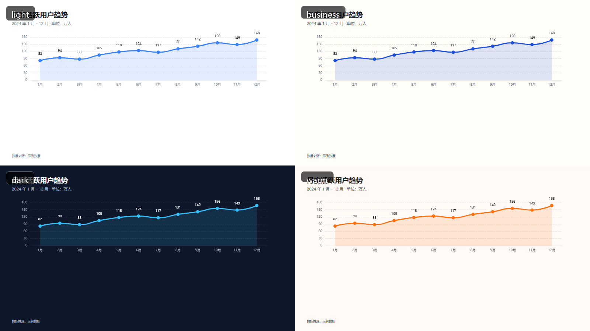
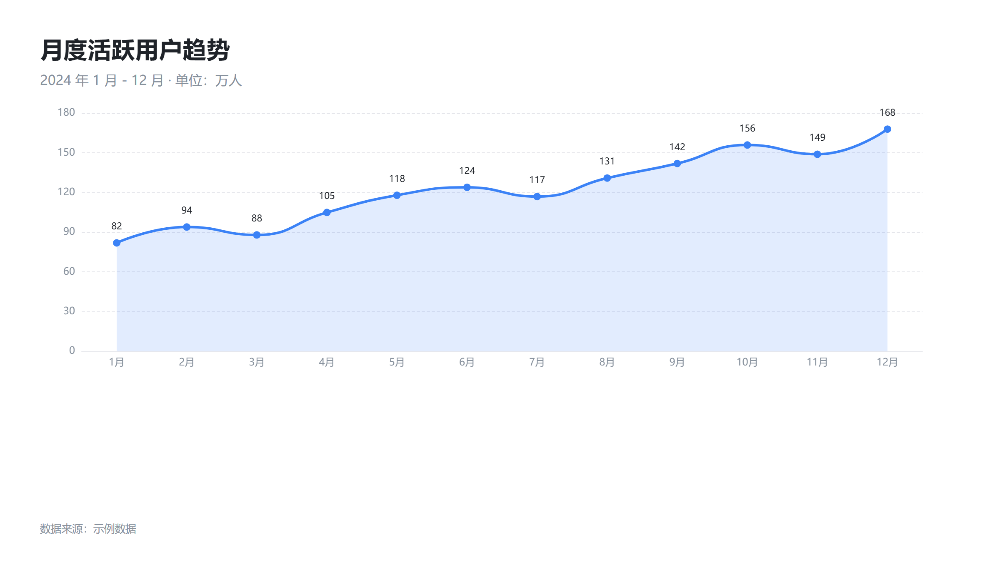
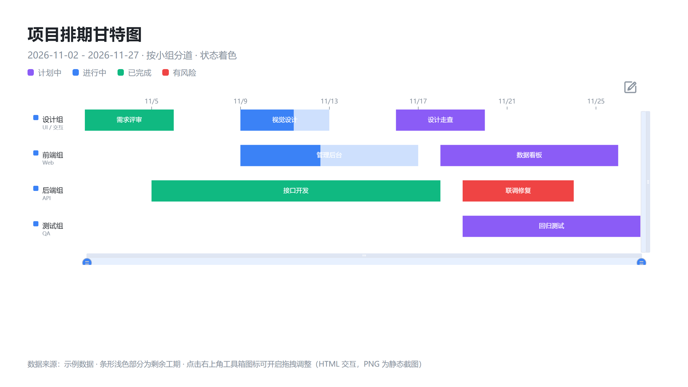
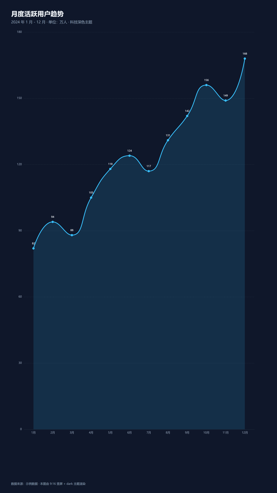
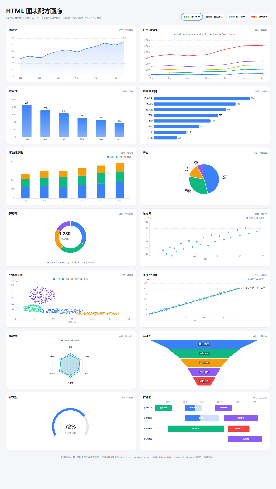

# html-visualization

> Turn data into a ready-to-share chart image: generate a single-page HTML chart with ECharts, then render it to a PNG at exactly the aspect ratio you specify (16:9, 1:1, 9:16, ...).

把数据渲染成 HTML 图表，再按指定的长宽比导出为高清 PNG。面向「提供数据 → 要一张能直接发出去的图」的场景：汇报封面、社交媒体方图、手机竖屏海报、项目排期图等。

<p align="center">
  
</p>

## 效果展示

<table>
  <tr>
    <td width="412">折线趋势 · <code>light</code> · 16:9</td>
    <td width="412">项目甘特图 · <code>light</code> · 16:9</td>
  </tr>
  <tr>
    <td width="412"></td>
    <td width="412"></td>
  </tr>
  <tr>
    <td width="412">竖屏海报 · <code>dark</code> · 9:16</td>
    <td width="412">14 种图型总览（<code>gallery.html</code>）</td>
  </tr>
  <tr>
    <td width="412"></td>
    <td width="412"></td>
  </tr>
</table>

> 以上截图均由 [`scripts/build-examples.py`](scripts/build-examples.py) 一键重建；可直接渲染的示例文件见 [`examples/`](examples/)。

## 适合谁用

| 你是 | 典型用法 |
|------|----------|
| 需要汇报的职场人 | 周报 / 月报数据图，16:9 直接放进 PPT |
| 内容创作者 | 公众号、知乎、小红书配图，1:1 / 3:4 / 9:16 适配各平台 |
| 项目经理 | 项目排期甘特图，替换任务数据即得成品 |
| 开发者 / AI Agent | `html2img.py` 可编程调用，数据 → HTML → PNG 全自动 |

## 特性

- **14 种常用图型**：折线、堆叠折线、柱状、横向条形、堆叠柱状、饼图、环形、散点、分布散点、线性回归、雷达、漏斗、仪表盘、甘特图
- **4 套主题**：简约浅色 `light`、商务蓝金 `business`、科技深色 `dark`、暖色活力 `warm`
- **任意长宽比**：`16:9`、`4:3`、`1:1`、`3:4`、`9:16`、`21:9` 或任意 `W:H`
- **离线可用**：内置本地 ECharts，CDN 不可达时自动兜底
- **像素级校验**：脚本会校验 PNG 实际尺寸与目标比例一致，不一致直接报错

## 快速开始

### 环境要求

| 依赖 | 说明 |
|------|------|
| Python | 3.8+ |
| Pillow | 用于校验输出 PNG 尺寸（`pip install pillow`） |
| Chrome / Edge / Chromium | 无头模式截图，脚本会自动发现，也可显式指定 |

脚本仅依赖 Python 标准库 + Pillow；图表运行在浏览器中，ECharts 已内置于 `assets/echarts.min.js`。

### 30 秒出图

```bash
git clone <your-repo-url> html-visualization
cd html-visualization
pip install pillow

cp templates/echarts-template.html chart.html
# 编辑 chart.html：按注释 ①-⑦ 替换标题、副标题、脚注与数据
python scripts/html2img.py chart.html
# → chart.png，2400×1350 高清 PNG
```

> 甘特图请改用 `templates/gantt-template.html`：它基于 ECharts 官方「机场航班甘特图」示例改写，内置车道泳道、状态着色、进度分层、`dataZoom` 缩放与工期条拖拽，只需替换 `LANES` / `TASKS` 数据。

### 预览全部图型与主题

直接用浏览器打开 `templates/gallery.html`，右上角切换 4 套主题；也可以用 URL 参数指定初始主题：

```
templates/gallery.html?theme=dark
```

### 常用尺寸速查

```bash
# 方形社交图：1080 × 1080
python scripts/html2img.py chart.html --ratio 1:1 --width 1080

# 手机竖屏图：1080 × 1920
python scripts/html2img.py chart.html --ratio 9:16 --width 1080 --out poster.png

# 小红书竖版卡片（3:4）：1080 × 1440
python scripts/html2img.py chart.html --ratio 3:4 --width 1080

# 宽幅 banner：1600 × 686
python scripts/html2img.py chart.html --ratio 21:9 --width 1600

# 直接指定视口宽高（优先于 --ratio）
python scripts/html2img.py chart.html --width 1200 --height 800
```

成功时输出 JSON：

```json
{
  "ok": true,
  "result": {
    "output": "H:\\path\\to\\chart.png",
    "viewport": { "width": 1200, "height": 675 },
    "pixels": { "width": 2400, "height": 1350 },
    "ratio_actual": 1.7778,
    "scale": 2,
    "browser": "C:\\Program Files\\Google\\Chrome\\Application\\chrome.exe"
  }
}
```

只有 `ok: true` 且 `pixels` 与目标一致才算成功；失败时返回 `ok: false` 与非零退出码。

### 重建展示截图

本 README 用到的全部截图可一键重建（themes-comparison 拼接图需 Pillow）：

```bash
python scripts/build-examples.py            # 重建 docs/showcase/ 全部 5 张
python scripts/build-examples.py --list     # 查看任务列表
python scripts/build-examples.py --only line-trend,gallery-overview
```

## 命令行参数

| 参数 | 默认值 | 说明 |
|------|--------|------|
| `html_file` | 必填 | 图表 HTML 文件路径 |
| `--out` | 与 HTML 同名 `.png` | 输出 PNG 路径 |
| `--width` | `1200` | 视口逻辑宽度 px |
| `--height` | 由 `--ratio` 换算 | 视口逻辑高度 px，指定后忽略 `--ratio` |
| `--ratio` | `16:9` | 长宽比，`W:H` 或单数值 `n`（表示 `n:1`） |
| `--scale` | `2` | 设备像素倍率；输出像素 = 视口 × scale。`1` 屏幕、`2` 视网膜、`3` 印刷 |
| `--browser` | 自动发现 | 浏览器可执行文件路径 |
| `--no-dom-check` | 关闭 | 跳过 DOM 加载校验（不建议） |

环境变量 `HTMLVIZ_BROWSER` 可以指定浏览器路径，效果等同 `--browser`。

## 图型选型速查

| 数据特征 | 推荐图型 |
|----------|----------|
| 单指标随时间变化（≥4 个时间点） | 折线图 |
| 多指标随时间变化（2-4 条） | 多系列折线 / 分组柱状 |
| 多系列累计总量 | 堆叠折线图 / 堆叠面积图 |
| 少量类别比较 | 柱状图 |
| 类别多或标签长 | 横向条形图（按值排序） |
| 构成占比（≤6 项） | 环形图 / 饼图 |
| 两连续变量关系 | 散点图 |
| 大量样本按类别看分布 | 分布散点图 |
| 需要趋势线与拟合优度 | 线性回归图（标注公式与 R²） |
| 3-8 维能力对比 | 雷达图 |
| 流程 / 漏斗转化 | 漏斗图 |
| 单个 KPI 达成率 | 仪表盘 |
| 任务 / 事件起止区间，按车道分行 | 甘特图 |

完整的 19 条判定规则、4 套主题令牌、14 种 ECharts 配方与设计规范见 [`references/chart-design.md`](references/chart-design.md)。

## 主题

| 主题 | 风格 | 适用场景 |
|------|------|----------|
| `light` | 简约浅色，蓝灰点缀 | 默认通用，屏幕阅读与文档插图 |
| `business` | 米白底 + 深蓝金 | 正式汇报、商务材料 |
| `dark` | 深蓝底 + 霓青高亮 | 科技感演示、深色幻灯片 |
| `warm` | 暖白底 + 橙红活力 | 社交媒体、轻松风格内容 |

切换方式：修改 `body` 标签的 `data-theme` 属性即可，无需改任何颜色代码。

## 项目结构

```
html-visualization/
├── SKILL.md                        # Agent Skill 说明：数据 → 图型 → HTML → PNG 工作流
├── README.md
├── LICENSE
├── assets/
│   └── echarts.min.js              # 本地 ECharts（离线兜底）
├── docs/
│   └── showcase/                   # README 展示截图（build-examples.py 产出）
├── examples/                       # 可直接渲染的示例（见 examples/README.md）
│   ├── README.md
│   ├── line-trend.html             # 16:9 折线图
│   ├── vertical-dark.html          # 9:16 竖屏 + dark 主题
│   └── gantt-schedule.html         # 16:9 甘特图
├── references/
│   └── chart-design.md             # 图型判定表、主题令牌、ECharts 配方、设计规范
├── scripts/
│   ├── html2img.py                 # HTML → 指定比例 PNG 渲染脚本
│   ├── build-examples.py           # 一键重建 docs/showcase/ 展示截图
│   └── build-skill-zip.py          # 打包 Agent Skill zip（产出 dist/，不入库）
└── templates/
    ├── echarts-template.html       # 单图模板（4 套主题，自带可渲染示例）
    ├── gantt-template.html         # 甘特图模板（custom series + dataZoom + 拖拽）
    └── gallery.html                # 14 种图型 × 4 套主题交互预览
```

## 工作原理

1. 按 `--width` 与 `--ratio` 换算出视口逻辑尺寸（高度上限 32000px，Chromium 限制）。
2. 在 HTML 末尾注入一个隐藏哨兵元素，写出临时副本，保留原目录的相对资源路径。
3. 调用 Chrome / Edge / Chromium 的 `--headless=new --screenshot` 一次性截图，`--force-device-scale-factor` 透传倍率。
4. 用 `--dump-dom` 确认浏览器真的加载了目标文档，避免截到浏览器起始页。
5. 用 Pillow 校验 PNG 像素尺寸与目标比例一致，不一致即报错。
6. 把产物复制到 `--out` 指定路径，清理临时目录。

## 作为 Agent Skill 使用

`SKILL.md` 是一份面向 AI Agent 的技能说明，包含按序执行的工作流：解析数据特征 → 确认喜好与输出参数 → 选型选主题 → 生成 HTML → 渲染 PNG → 视觉自检后交付。

### 安装到 Agent

方式一：整个仓库作为 skill（含 README、示例与展示截图）：

```bash
git clone <your-repo-url> skills/html-visualization
```

方式二：精简 skill zip（只含技能运行所需的 8 个文件，体积更小）：

```bash
# 从 GitHub Releases 下载，或本地构建：
python scripts/build-skill-zip.py
# → dist/html-visualization-skill.zip

# 解压到 Agent 的 skills 目录（Windows 也可用资源管理器解压后放入）
unzip dist/html-visualization-skill.zip -d skills/
```

方式二解压后的结构：

```
skills/html-visualization/
├── SKILL.md                    # 技能入口：工作流、命令速查、常见错误
├── LICENSE
├── assets/echarts.min.js       # 离线 ECharts 兜底
├── references/chart-design.md  # 选型判定表、主题令牌、14 种配方
├── scripts/html2img.py         # HTML → PNG 渲染脚本
└── templates/                  # 单图 / 甘特 / gallery 预览，共 3 个模板
```

### 构建 skill zip（维护者）

```bash
python scripts/build-skill-zip.py --list   # 查看将打入 zip 的文件
python scripts/build-skill-zip.py          # 构建 dist/html-visualization-skill.zip
python scripts/build-skill-zip.py --out release/skill-v1.zip
```

zip 只包含技能运行所需文件（SKILL.md、模板、渲染脚本、离线 ECharts、参考文档、LICENSE），采用固定时间戳打包——同一份源码多次构建产物完全一致（可复现构建），可直接附加到 GitHub Releases。

## 常见问题

| 现象 | 原因与处理 |
|------|-----------|
| 图表空白 | CDN 不可达且本地兜底路径错误。检查 `../assets/echarts.min.js` 相对路径，HTML 移动后同步修正 |
| 截图比例漂移 | 页面存在固定宽高或滚动条。确保 `html, body { width/height: 100%; overflow: hidden }`，图表区 `flex: 1` |
| 中文显示为方块 | 系统缺少中文字体。安装 Noto Sans CJK / 思源黑体，或换用模板字体栈中的可用字体 |
| 找不到浏览器 | 用 `--browser` 显式指定路径，或设置 `HTMLVIZ_BROWSER` 环境变量 |
| 渲染超时 | 默认 90 秒，检查是否引入了阻塞加载的外部资源 |
| 尺寸校验失败 | PNG 实际尺寸与期望不符，通常是页面强制尺寸样式导致 |

## Roadmap

- 地图类图型（`registerMap` + 本地 GeoJSON）
- graph 关系图 / 桑基图专用模板
- 批量渲染：一份 JSON 配置一次产出全套图表
- 英文文档

## 第三方组件与致谢

- [Apache ECharts](https://echarts.apache.org/) 5.5.1 — Apache License 2.0，`assets/echarts.min.js` 为官方发行文件
- `templates/gantt-template.html` 参考 ECharts 官方「机场航班甘特图」示例改写

## License

[MIT](LICENSE)
